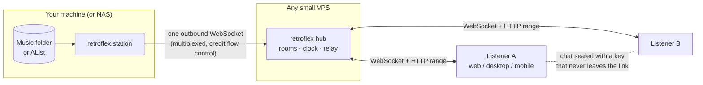

<p align="center"></p>

<h1 align="center">Retroflex</h1>

<p align="center"><b>Listen together, without a center.</b></p>

Retroflex is a small listening-room system for people who own their music. Two
or more people hear the same song at the same moment, as if sharing one pair of
earphones in the back of a classroom, while typing to each other in a room that
feels like an early-internet chat. If you want, they can watch each other's
words appear letter by letter, hesitations and backspaces included.

There are no accounts, no database and no recommendation feed. Music stays on
the machine that owns it. A room exists only in a hub's memory while someone is
in it, and a few minutes after the last person leaves it is gone.

- **Web**, installable as a PWA (this is also the iPhone and iPad path for now)
- **macOS, Windows, Linux** via Tauri v2
- **Android** via Tauri v2 (APK)
- **iOS** via Tauri v2 (build in Xcode with your own signing team)

Every platform runs the same interface, styled after Apple Music and Lyricify:
a fluid backdrop painted from the cover, a large cover with transport controls,
and lyrics that scroll and blur around the current line. The interface is made
of icons and content only, with no explanatory text.

## How it fits together



**Station.** Indexes a local folder or an [AList](https://alist.nn.ci) share,
reads tags, covers and lyrics (embedded, or `.lrc` and `cover.jpg` sidecars),
makes thumbnails, and keeps a probe memo so rescans are cheap. It never opens a
port: it dials the hub and answers requests over that one connection.

**Hub.** Holds rooms in memory, answers clock pings, relays the station's bytes
to listeners with HTTP range support, and serves the web app embedded in its own
binary. It keeps nothing on disk. Anyone can run one; a link always names the hub
it belongs to.

**App.** One Svelte 5 code base. The browser gets it from the hub; desktop and
mobile builds wrap the same files in Tauri v2.

Both server roles live in a single static Rust binary, `retroflex`.

## Staying in step

Each client estimates the hub's clock from a burst of pings and then keeps
pinging. It trusts the reply with the shortest round trip, because the
shortest exchange has the least room for asymmetric delay (Cristian's
algorithm). Small corrections are eased in; large ones are taken at once.

The hub never says "play now". It says "this track, from this second, starting
at hub time T", and puts T about 450 ms in the future so every listener can
seek and buffer before it arrives. After that each client compares what its
audio element is playing with where the room's timeline says it should be:

| drift | response |
| --- | --- |
| under 15 ms | nothing |
| 15 to 350 ms | nudge `playbackRate` by up to 4% until it closes, pitch preserved |
| over 350 ms | seek |

Where the browser reports it, output latency (for example Bluetooth earbuds) is
added so the moment you *hear* matches, not the moment the decoder runs. Over a
260 ms round trip between continents, test clients held within about ±12 ms of
the shared timeline.

## What the hub can and cannot see

| | hub sees | hub does not see |
| --- | --- | --- |
| audio | bytes it relays, track titles in the queue | |
| people | how many connections a room has | names, colours |
| words | ciphertext lengths | chat lines, live drafts |

A room link looks like `https://hub/#/r/<room>/<secret>`. The part after `#` is
never sent to any server. From the secret, each client derives two independent
keys with HKDF-SHA256: a **ticket** that the hub checks before letting you in or
streaming you audio, and a **seal** key that encrypts chat, drafts and profiles
with XChaCha20-Poly1305. The hub learns the ticket but cannot derive the seal
from it.

To open a room you need the **station key**, printed by `retroflex station` as a
station link. Hand that only to people you would hand your record collection.

## Quick start

You need Rust (stable) and Node 22.

```sh
cd app && npm ci && npm run build && cd ..
cargo build --release
```

Run a hub (here on your own machine):

```sh
RETROFLEX_HUB_TOKEN=change-me ./target/release/retroflex hub --listen 127.0.0.1:7746
```

Share a library through it:

```sh
RETROFLEX_HUB_TOKEN=change-me ./target/release/retroflex station \
  --name home --hub http://127.0.0.1:7746 \
  -l ~/Music \
  -l "http://nas.local:5244/Music"
```

The station prints a station link. Open it, choose something, and a room is
created; the link icon copies the room link for whoever you want beside you.

| flag / env | used by | meaning |
| --- | --- | --- |
| `--listen` / `RETROFLEX_LISTEN` | hub | address to bind, default `127.0.0.1:7746` |
| `--token` / `RETROFLEX_HUB_TOKEN` | both | shared secret that admits stations |
| `--name` / `RETROFLEX_NAME` | station | name used in links, `a-z 0-9 -` |
| `--library`, `-l` | station | folder or AList folder URL, repeatable |
| `--hub` / `RETROFLEX_HUB` | station | hub URL, `https://` or `http://` |
| `--alist-token` / `RETROFLEX_ALIST_TOKEN` | station | for private AList folders |
| `--cache` / `RETROFLEX_CACHE` | station | tags, covers, thumbnails and the station key |
| `--rescan` | station | minutes between rescans, default 30 |

Formats are played by the platform's own decoder, so anything the browser or
webview can play works: MP3, AAC/M4A, FLAC, Ogg Vorbis/Opus, WAV, WebM. Lyrics
can be LRC, including translation lines that share a timestamp, or plain text.
Legacy GBK lyric files are decoded too.

## Hosting a hub on a VPS

The hub needs about 10 MB of RAM and no disk. `deploy/install.sh` puts it on a
Linux machine next to whatever else is there: everything goes under
`/opt/retroflex` and `/etc/retroflex`, both services run with
`DynamicUser=yes`, and nothing listens on a public port, because traffic arrives
through a Cloudflare Tunnel.

```sh
cloudflared tunnel create retroflex
cloudflared tunnel route dns retroflex listen.example.org
cargo zigbuild --release --target x86_64-unknown-linux-musl
scp target/x86_64-unknown-linux-musl/release/retroflex ~/.cloudflared/<id>.json deploy/* root@vps:/tmp/rf/
ssh root@vps 'cd /tmp/rf && sh install.sh ./retroflex ./<id>.json listen.example.org'
```

The installer prints the hub token for your stations.

To keep a library on the VPS itself, copy it to `/srv/retroflex/music`, write
`RETROFLEX_NAME`, `RETROFLEX_HUB=http://127.0.0.1:7746` and
`RETROFLEX_PUBLIC_URL=https://listen.example.org` into
`/etc/retroflex/station.env`, and enable `deploy/retroflex-station.service`.

## Apps

Releases are built by GitHub Actions when a `v*` tag is pushed:

- `retroflex` binaries for Linux (x86_64, aarch64, static musl), macOS (Apple silicon) and Windows
- desktop bundles: universal `.dmg` for macOS, `.msi` and `.exe` for Windows, `.AppImage` and `.deb` for Linux
- an Android `.apk` (signed with `ANDROID_KEYSTORE` and `ANDROID_KEYSTORE_PASSWORD` secrets if present, otherwise with a throwaway key)

iOS needs your own Apple team: `cd app && npx tauri ios init && npx tauri ios
build`. Until then, open any link in Safari and add it to the home screen; lock
screen controls work through the Media Session API.

In the desktop and mobile apps, paste a station or room link on the first
screen; the app remembers which hub it came from.

## Development

```sh
cargo run -- hub --token dev                    # terminal 1
cargo run -- station --name dev --hub http://127.0.0.1:7746 --token dev -l ~/Music   # terminal 2
cd app && npm run dev                           # http://localhost:5173, proxies /api to the hub
cd app && npm run tauri dev                     # desktop shell around the dev server
```

`cargo test` covers the protocol, ranges, scanning helpers and room logic;
`npm test` and `npm run check` cover the client.

```
crates/retroflex   hub + station (Rust: tokio, axum, lofty, ureq, image)
app/src/lib        room session, player, clock, crypto, lyrics, links
app/src/ui         Svelte 5 components
app/src-tauri      Tauri v2 shell
deploy             systemd units and installer
```

Every comment in the code base is a haiku, written in Japanese.

## Choices, and what was left out

This design started from a more maximal proposal. What survived, and why:

| proposed | here | reason |
| --- | --- | --- |
| Local-first, ephemeral rooms, no central database | kept | the point of the project |
| Rust core, Tauri v2, Svelte 5 runes | kept | one binary for servers, one UI for six platforms |
| Scheduled playback at a future timestamp | kept | the core of good sync |
| PLL-style resampling instead of hard seeks | kept, as `playbackRate` nudging | same idea, using the platform's own resampler |
| Live keystroke mode | kept | it is the best part |
| Leaderless shared queue | kept | everyone in a room has the same controls |
| BLAKE3 | kept, for IDs and key hashes | streaming Merkle verification is unnecessary over TLS from your own station |
| Iroh / QUIC hole punching | left out | browsers cannot open raw UDP, so web clients would need a relay anyway; one outbound WebSocket per station is simpler and works behind any NAT |
| WebTransport / Media over QUIC | left out | uneven browser support, and plain HTTP range requests already stream well |
| MLS group encryption | left out | rooms have no membership management; a key carried in the link plus an AEAD covers the threat model |
| Loro CRDT for the queue | left out | the hub already orders every command, so there are no concurrent edits to merge |
| WASM decoder, AudioWorklet, SharedArrayBuffer | left out | needs cross-origin isolation, which breaks cross-origin media; native decoders are good enough |
| Kalman-filtered clock | left out | min-RTT selection is simpler and does as well here |
| Cloudflare Durable Objects | left out | a hub on a small VPS costs nothing extra and keeps the relay yours |

What the hub relays is still visible to whoever runs the hub. If that matters
to you, run your own; it is one command.

## License

[AGPL-3.0-or-later](LICENSE). If you run a modified hub for others, share the changes.
